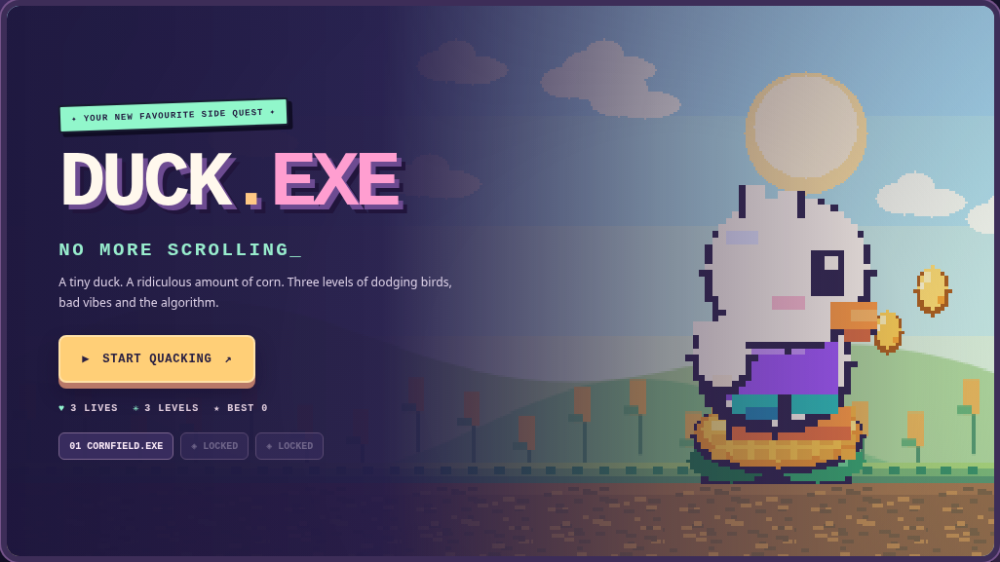
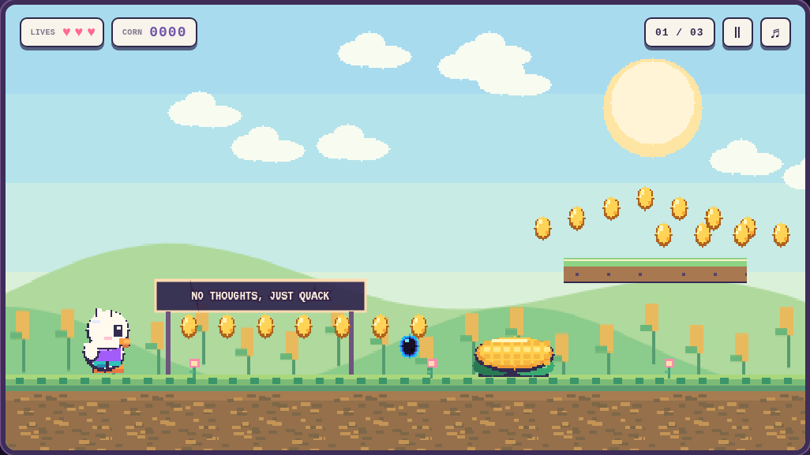
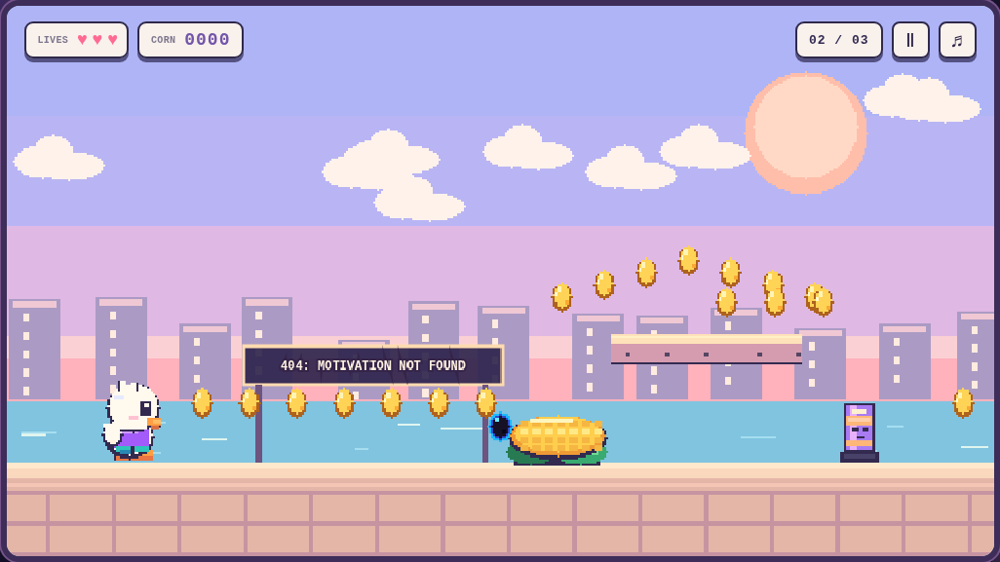
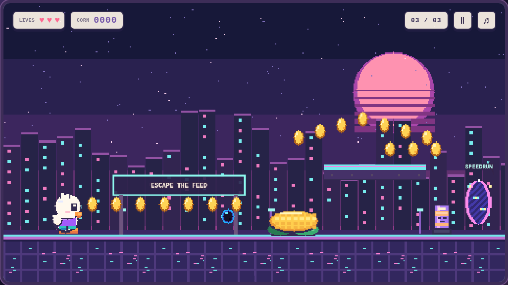

# 🦆 DUCK.EXE — No More Scrolling

**Полностью оригинальная браузерная пиксельная игра** про утёнка, кукурузу и интернет-зависимость. Три игровых уровня: **CORNFIELD.EXE**, **SEAGULL CITY**, **THE INFINITE SCROLL**.



## Играть сразу, без установки

Откройте **`public/instant-play.html`** двойным кликом в браузере. Это полностью автономная игровая версия на Canvas 2D: все спрайты и программно созданный звук включены непосредственно в HTML. Интернет, сервер, Node.js и сборка не требуются.

При публикации на GitHub Pages автономная версия также будет доступна по адресу `https://USERNAME.github.io/REPOSITORY/instant-play.html`.

## Основной проект (Phaser 3 + TypeScript + Vite)

Потребуются **Node.js 22+**, **npm** и подключение к интернету при первом `npm install`.

```bash
npm install
npm run dev
```

Откройте адрес, который появится в терминале (обычно `http://localhost:5173/`).

Собрать и проверить продакшен-версию:

```bash
npm run build
npm run preview
```

Проверить геометрию всех уровней и безопасность контрольных точек:

```bash
npm run check:maps
```

Опциональная проверка типов: `npm run typecheck`.

## Публикация на GitHub Pages

1. Создайте **новый публичный репозиторий** GitHub, например `duck-exe`.
2. Загрузите в него файлы **из папки проекта**, включая скрытую папку `.github` (`.github/workflows/deploy.yml`). Архив нужно предварительно распаковать.
3. Убедитесь, что основная ветка называется `main`.
4. Откройте **Settings → Pages → Build and deployment**, выберите **GitHub Actions**.
5. При отправке изменений в ветку `main` процесс `Deploy Duck.EXE to GitHub Pages` установит зависимости, проверит карты уровней, соберёт проект и развернёт его в Pages.
6. Ссылка на игру: `https://ВАШ-ЛОГИН.github.io/duck-exe/`. На собственном домене путь будет отличаться.

Настройка `base: './'` в `vite.config.ts` позволяет публиковать игру и в подпапке репозитория, и на собственном домене. При необходимости можно задать переменную окружения `BASE_PATH`.

## Управление

| Действие | Клавиатура | Телефон |
|---|---|---|
| Движение влево / вправо | `A` / `D` или `←` / `→` | Экранные кнопки со стрелками |
| Прыжок | `Space`, `W`, `↑` | Кнопка `JUMP` |
| Пауза | `P` / `Esc` | Кнопка `Ⅱ` |
| Повторить игру после поражения | `R` | `ONE MORE TRY?` |
| Звук | Кнопка `♫` | Кнопка `♫` |

На телефоне удобнее играть **в горизонтальной ориентации**, хотя есть адаптивная портретная разметка.

## Механики

- **Жизни:** 3; столбики и падение в яму отнимают одну жизнь; возрождение на контрольной точке даёт 2 секунды неуязвимости.
- **Золотое зерно:** +10 очков. **Чёрное зерно:** −20 очков, но не ниже нуля.
- **Кукурузный батут:** подбрасывает утёнка на высокие платформы.
- **Чайки:** летают предсказуемо, крадут по 15 очков и улетают.
- **Touch Grass** и **Emotional Support Corn:** восполняют жизнь, максимум 3.
- **Do Not Disturb:** 5 секунд защиты от чаек и чёрных зёрнышек.
- **Side Quest:** спрятанная награда +50 очков.
- **Duck Rizz:** после серии из 10 зёрен появляется двухсекундная сияющая аура.
- **Speedrun Portals:** временные порталы для перескакивания сложных участков; каждый даёт +25 очков.
- **Doomscroll Phone:** коснувшись телефона в конце третьего уровня, утёнок начинает залипать в нём, и игра заканчивается независимо от оставшихся жизней. Телефон можно перепрыгнуть.
- Прогресс доступных уровней, рекорд и настройка звука хранятся в `localStorage`.

## Скриншоты

| Кукурузное поле | Приморский город | Цифровой мир |
|---|---|---|
|  |  |  |

## Структура

```text
duck-exe/
├── .github/workflows/deploy.yml  # Автоматическое развёртывание GitHub Pages
├── public/
│   ├── favicon.svg
│   └── instant-play.html         # Автономная HTML-версия игры
├── src/
│   ├── game/
│   │   ├── art.ts                # Оригинальная программная пиксельная графика
│   │   ├── audio.ts              # Оригинальные звуки и музыка (WebAudio)
│   │   ├── levels.ts             # Три спроектированные карты и их валидация
│   │   └── ui.ts                 # Старт, пауза, HUD, поражение, победа
│   ├── main.ts                   # Phaser 3, физика, препятствия, сцены
│   └── style.css                 # Адаптивная оболочка и мобильное управление
├── scripts/check-maps.mjs
├── screenshots/
├── index.html
├── package.json
├── tsconfig.json
└── vite.config.ts
```

## Проверки и ограничения

- Автономная HTML-игра прогнана в Chromium в автоматизированных сценариях: движение, прыжок, начисление очков, прохождение уровней, контрольные точки, портал, бонус защиты, потери жизни, проигрыш от телефона и интерфейс телефона в портретной ориентации.
- `npm run check:maps` проверяет вручную спроектированные карты, ширину всех провалов, положение контрольных точек и точки выхода из порталов.
- Основной проект написан на Phaser 3/TypeScript и подготовлен к сборке Vite. Если пакетный реестр npm временно недоступен, используйте автономный `instant-play.html`.

## Права

Все спрайты, карты, анимации, музыка и звуковые эффекты оригинальные и сгенерированы кодом проекта. Ассеты Nintendo, чужие мелодии и внешние изображения не используются. Код проекта распространяется под MIT License. Phaser распространяется по собственной лицензии MIT, входящей в зависимость npm.
